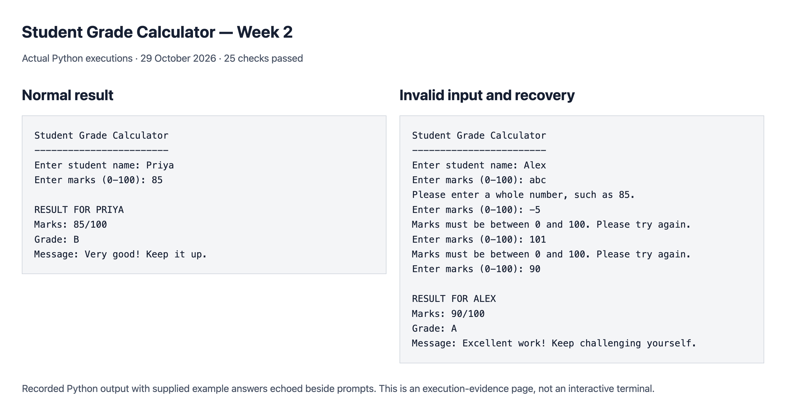

# Student Grade Calculator

Week 2 project for The Developers Arena Data Science internship.

## Project overview

The program asks for a student's name and marks, validates the answers, and displays a grade with an encouraging message. It demonstrates decisions with `if-elif-else`, repetition with `while`, reusable functions, and handling invalid number input with `try-except`.

## Setup and running

Use Python 3.8 or newer. No packages, internet connection, or machine-specific paths are needed to run the project. Download the repository ZIP and extract it, or clone the repository. Open a terminal in the extracted project folder.

On macOS or Linux:

```sh
python3 grade_calculator.py
```

On Windows:

```powershell
py -3 grade_calculator.py
```

If your Python installation uses the `python` command instead, run `python grade_calculator.py`. You can also open the file in Python IDLE and choose Run Module. Enter a name, then enter a whole-number mark from 0 to 100. The output uses plain text for compatibility with different terminals.

The code was executed on macOS with Python 3.14.5. Windows and Linux instructions are provided, but those operating systems were not tested here.

## Files

```text
grade_calculator.py       Main project
grading_rules.md          Grade ranges and validation policy
practice.py               Supporting Week 2 exercises
requirements.txt          No external dependencies
test_cases.txt            Actual test cases and results
sample_runs.txt           Recorded program runs
screenshots/
    grade_calculator.png  Screenshot of recorded execution evidence
README.md                 This documentation
```

## Grading logic

| Whole-number marks | Grade |
| --- | --- |
| 90–100 | A |
| 80–89 | B |
| 70–79 | C |
| 60–69 | D |
| 0–59 | F |

The conditions are checked from highest to lowest. For 85 marks, the A condition is false, the B condition is true, and the program returns B with “Very good! Keep it up.” Each grade has its own encouraging message.

## Functions and control flow

- `calculate_grade(marks)` returns a pair containing the grade and message. Its `if-elif-else` chain implements the ranges above.
- `read_marks()` uses a `while True` loop to repeat the prompt until the input is valid. `int()` converts the answer to a whole number. A `ValueError` is caught for invalid text, and an explicit range check rejects marks outside 0–100.
- `main()` reads a non-empty student name, calls the two functions, and prints the result.
- The `if __name__ == "__main__"` block runs the program when the file is executed and allows its functions to be imported for testing without starting the questions.

The program accepts whole marks only: `85.5` and `85.0` are rejected instead of rounded. It also rejects blank marks, text, negative marks, and marks above 100. Surrounding spaces are removed. EOF or Ctrl+C cancels without producing a partial grade. Names and marks are held in memory and are not saved or transmitted.

## Step-by-step implementation

1. Write the grade ranges in `grading_rules.md`.
2. Ask for the student name and marks with `input()`.
3. Put the grade decisions in `calculate_grade()`.
4. Add the input retry loop and number/range validation in `read_marks()`.
5. Combine the parts in `main()`, format the result, and check grade boundaries and invalid inputs.

## Example

```text
Student Grade Calculator
------------------------
Enter student name: Priya
Enter marks (0-100): 85

RESULT FOR PRIYA
Marks: 85/100
Grade: B
Message: Very good! Keep it up.
```

## Testing and screenshot

`test_cases.txt` records the executed checks, including every grade boundary, invalid input followed by a successful retry, blank names, and cancellation. `sample_runs.txt` contains recorded output for the normal and validation examples.



The screenshot displays recorded output from actual Python executions in a browser evidence page. Supplied example answers are shown beside the prompts. It is not a screenshot of an interactive terminal session.

## Additional practice and learning notes

Run `python3 practice.py` (or `py -3 practice.py` on Windows) for time-of-day decisions, a loop printing 1–100, a rectangle-area function, arithmetic operations, age categories, and a guessing game. The example hour, age, and rectangle dimensions can be changed in the script.

The key ideas are that conditions choose a path, loops repeat a step, and functions let the same logic be reused. Catching an invalid conversion lets the program explain the problem and ask again instead of crashing. Checking the highest grade first makes the conditions shorter without changing the grade ranges.
